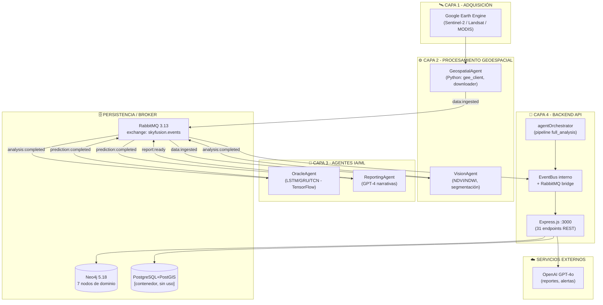
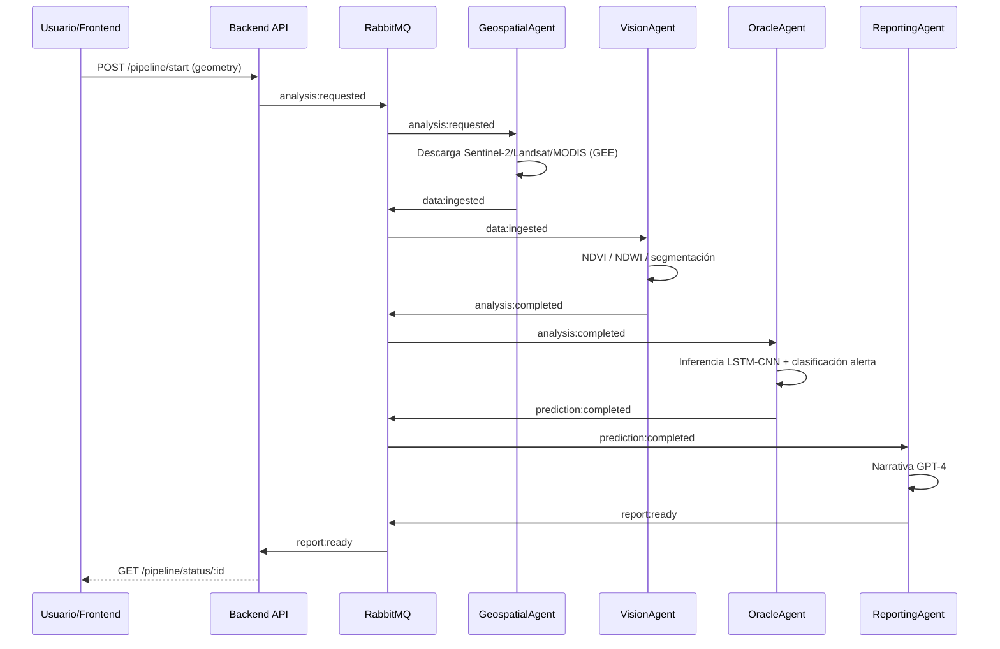

# 🌊 Skyfusion Analytics — Documentación Técnica

**Versión del documento:** 1.0
**Fecha:** 18 de octubre de 2026
**Estado del proyecto:** En desarrollo (Fase backend + agentes + pipeline ML)
**Metodología:** CRISP-DM (módulo de modelado) + arquitectura por capas/event-driven

> Este documento describe el estado **real** del código fuente del repositorio. Cuando se menciona el diseño aspiracional (frontend, despliegues cloud, etc.) se señala de forma explícita como **no implementado**.

---

## Índice

1. [Título del Proyecto y Resumen Ejecutivo](#1-título-del-proyecto-y-resumen-ejecutivo)
2. [Arquitectura y Stack Tecnológico](#2-arquitectura-y-stack-tecnológico)
3. [Módulos e Infraestructura Desarrollados](#3-módulos-e-infraestructura-desarrollados)
4. [Estructura del Proyecto](#4-estructura-del-proyecto)
5. [Modelos de Datos y Entidades](#5-modelos-de-datos-y-entidades)
6. [Instalación y Despliegue Local](#6-instalación-y-despliegue-local)
7. [Roadmap y Próximos Pasos](#7-roadmap-y-próximos-pasos)
8. [Problemas Conocidos y Deudas Técnicas](#8-problemas-conocidos-y-deudas-técnicas)

---

## 1. Título del Proyecto y Resumen Ejecutivo

### 1.1 Identificación

| Campo | Valor |
|-------|-------|
| **Nombre** | Skyfusion Analytics |
| **Tipo** | Plataforma SaaS de análisis multitemporal y predicción ambiental |
| **Dominio** | Monitoreo y gestión de cuencas hidrográficas |
| **Área de estudio** | Cuenca del río Combeima, Ibagué (Tolima), Colombia |
| **Licencia** | Proprietary |
| **Repositorio** | `SKYFUSSION-ANALYTICSWEB` |

### 1.2 Visión General

Skyfusion Analytics integra **teledetección satelital** (Google Earth Engine), **sensores IoT** y **drones UAV** para ofrecer una visión holística del estado hídrico de un territorio. Su núcleo combina:

- **Redes neuronales** (LSTM, GRU, BiGRU, GRU+Attention, TCN) para predicción de series temporales de índices ambientales.
- **Procesamiento geoespacial** (NDVI, NDWI, segmentación de agua) sobre imágenes Sentinel-2 / Landsat / MODIS.
- **IA generativa** (GPT-4 / Azure OpenAI) para traducir métricas técnicas en narrativas comprensibles para decisores no técnicos.

### 1.3 Objetivos Principales

| # | Objetivo |
|---|----------|
| 1 | **Monitorear** variables ambientales críticas: caudal, precipitación, temperatura, humedad, cobertura vegetación (NDVI) |
| 2 | **Predecir** eventos climáticos extremos (ej. El Niño) mediante RNA sobre series multitemporales GEE |
| 3 | **Alertar** tempranamente a entidades gubernamentales y comunidades (niveles verde/amarillo/naranja/rojo) |
| 4 | **Evaluar** la oferta hídrica de la cuenca del Combeima (>500 000 habitantes abastecidos) |

### 1.4 Estado Actual del Desarrollo

| Capa / Módulo | Estado | Notas |
|---------------|--------|-------|
| Backend API Node.js | ✅ Implementado | 31 endpoints, ESM, Neo4j, RabbitMQ opcional |
| Agentes Python (4) | ✅ Implementados | Base + Geospatial/Vision/Oracle/Reporting |
| Agentes Node.js (4) | ✅ Implementados | Orchestrator, ingestion, analysis, prediction |
| Bus de eventos | ✅ Implementado | EventEmitter interno + RabbitMQ + bridge |
| Pipeline RNN (`rnn_combeima`) | ✅ Validado | 5 arquitecturas, datos reales MODIS (2015-2024) |
| Docker Compose | ⚠️ Parcial | Servicios definidos; **falta Dockerfile del backend** |
| PostgreSQL + PostGIS | ⚠️ Contenedor definido | **No conectado al backend** (solo Neo4j se usa) |
| Frontend (Capa 5) | ❌ No implementado | Diseño prevé React + Leaflet + Chart.js |
| Autenticación JWT | ❌ No implementada | Sin middleware de auth en rutas |
| Despliegue Azure | ❌ No implementado | Documentado en `ARQUITECTURA_AZURE.md` |
| Monitoreo (Prom/Grafana) | ⚠️ Perfil compose | Config no incluida en repo |
| Tests backend | ❌ No implementados | Jest+supertest en devDependencies, carpeta `tests/` ausente |

---

## 2. Arquitectura y Stack Tecnológico

### 2.1 Estilo Arquitectónico

Skyfusion implementa una **arquitectura híbrida** combinando dos estilos:

- **Arquitectura por capas (Layered)** — 6 niveles de abstracción (Capa 0-5).
- **Arquitectura orientada a eventos (Event-Driven)** — agentes autónomos que se comunican vía bus de mensajería (RabbitMQ / EventEmitter), sin dependencias directas.

```text
┌───────────────────────────────────────────────────────┐
│ Capa 5 - Presentación (Frontend)          [DISEÑO]    │  ← No implementada
├───────────────────────────────────────────────────────┤
│ Capa 4 - Backend API (Node.js + Express)  [✅ CÓDIGO] │
├───────────────────────────────────────────────────────┤
│ Capa 3 - Agentes IA / ML (Python)         [✅ CÓDIGO] │
├───────────────────────────────────────────────────────┤
│ Capa 2 - Procesamiento Geoespacial        [✅ CÓDIGO] │
├───────────────────────────────────────────────────────┤
│ Capa 1 - Adquisición de Datos (GEE)       [✅ CÓDIGO] │
├───────────────────────────────────────────────────────┤
│ Capa 0 - Infraestructura (Docker/Azure)   [⚠️ PARCIAL]│
└───────────────────────────────────────────────────────┘
```

### 2.2 Diagrama de Arquitectura (Estado Real)



### 2.3 Flujo de Eventos del Pipeline

El ciclo de vida de un análisis completo sigue este encadenamiento de eventos (patrón **event choreography**):



### 2.4 Stack Tecnológico

#### 2.4.1 Componentes Implementados (Código Real)

| Categoría | Tecnología | Versión | Uso en el proyecto |
|-----------|------------|---------|--------------------|
| Runtime backend | Node.js | ≥ 20 (ESM) | API REST, orquestación |
| Framework HTTP | Express.js | 4.18.2 | Routing, middleware |
| Base de datos grafo | Neo4j | 5.18 Community | Modelo de dominio (7 nodos) |
| Message broker | RabbitMQ | 3.13 | Event-driven entre agentes |
| Driver Neo4j | neo4j-driver | 5.18.0 | Consultas Cypher |
| Cliente AMQP | amqplib | 0.10.4 | Publicación/suscripción |
| Validación | Joi | 17.12.3 | Esquemas (definidos, no aplicados) |
| Seguridad HTTP | Helmet | 7.1.0 | Headers de seguridad |
| Rate limiting | express-rate-limit | 7.2.0 | Protección API |
| Logging | Winston | 3.12.0 | Logs a consola + archivos |
| LLM | OpenAI SDK | 4.52.0 | Reportes y alertas (GPT-4o) |
| Teledetección | @google/earthengine | 1.7.43 | Client GEE en Node |
| Runtime agentes | Python | 3.11 (Docker) | 4 agentes de ML/geoespacial |
| ML (agentes) | TensorFlow / PyTorch | según requirements | LSTM-CNN en OracleAgent |
| Visión | OpenCV / Rasterio | según requirements | Segmentación, índices |
| Orquestación | Docker Compose | 2.x | 10 servicios, 8 volúmenes |
| Documentación | Astro + Starlight | 0.41.3 | Sitio `docs/` |
| Pipeline ML | TensorFlow (Keras) | 2.20 | RNA en `rnn_combeima` |
| Datos GEE | earthengine-api | latest | Extracción multisensor |

#### 2.4.2 Stack Aspiracional (Diseño — No Implementado en este repo)

| Categoría | Tecnología | Estado |
|-----------|------------|--------|
| Frontend framework | **React** (diseño Azure) / Vue.js 3 (README legacy) | ❌ No existe carpeta de frontend |
| Mapas | Leaflet / Mapbox GL JS | ❌ |
| Gráficos | Chart.js / Plotly | ❌ |
| Base de datos relacional | PostgreSQL 16 + PostGIS 3.4 | ⚠️ Contenedor definido, backend no lo usa |
| Reverse proxy | Nginx | ⚠️ Referenciado en compose, carpeta `nginx/` ausente |
| Monitoring | Prometheus + Grafana | ⚠️ Perfiles compose, configs ausentes |
| Despliegue cloud | Azure (VM GPU, Blob Storage, OpenAI Service) | ❌ Solo documentado |
| Auth | JWT | ❌ Sin middleware |
| Realtime | WebSockets / Socket.IO | ❌ No implementado |

> **Nota de coherencia:** El `README.md` raíz menciona Vue.js, MongoDB y TensorFlow en procesamiento. El código real usa **Express + Neo4j + RabbitMQ**, y el frontend **aún no existe**. El documento `ARQUITECTURA_AZURE.md` especifica React para la Capa 5. Esta documentación prioriza el estado real del código.

### 2.5 Decisiones Arquitectónicas Clave

| Decisión | Justificación |
|----------|---------------|
| **Neo4j (grafo) como DB principal** | Las relaciones zonas↔estaciones↔sensores↔mediciones son grafo naturally; consultas deadyacencia (`CONTAINS`, rutas hidrográficas) y espaciales (`point.distance`) |
| **RabbitMQ con fallback a EventEmitter** | El backend funciona sin broker (dev local) y escala a mensajería real (producción) sin cambiar código de dominio |
| **Agentes con responsabilidad única** | Cada agente consume un evento y publica otro; escalable horizontalmente y reemplazable |
| **Pipeline RNN independiente** | `rnn_combeima/` es un proyecto de modelado autocontenido (CRISP-DM) desacoplado del backend |
| **Docker multi-stage / multi-agent** | Un solo `Dockerfile` Python parametrizado por `AGENT_NAME` para los 4 agentes |

---

## 3. Módulos e Infraestructura Desarrollados

### 3.1 Backend API — `services/backend-node/`

#### 3.1.1 Punto de Entrada (`src/app.js`)

Orden de configuración al arrancar:

1. `dotenv.config()`
2. `helmet()` — headers de seguridad
3. `cors` — origin configurable (`CORS_ORIGIN` o `*`)
4. `express.json({ limit: '10mb' })` + `urlencoded`
5. Logger inline (method, path, ip)
6. `rateLimiter` (ventana 15 min / 100 req por defecto)
7. `app.use('/api/v1', routes)`
8. `notFoundHandler` → 404 JSON
9. `errorHandler` → 500 JSON (con stack en desarrollo)

`startServer()` (async):
1. **Neo4j**: `initializeDatabase()` — driver, `verifyConnectivity`, crea 7 restricciones únicas sobre `id`. Pool: 50 conexiones, acquisition timeout 10 s.
2. **Validación externa**: warnings si faltan `GEE_SERVICE_ACCOUNT_EMAIL` u `OPENAI_API_KEY` (no aborta).
3. **RabbitMQ**: `rabbitMQClient.connect()`; si falla → log warn y modo solo eventBus local.
4. **HTTP**: `app.listen(PORT)` (default 3000).

Shutdown gracioso (`SIGTERM`/`SIGINT`): `agentOrchestrator.shutdown()` → `rabbitMQClient.disconnect()` → `closeDatabase()` → `exit`.

Scripts disponibles (`package.json`):

| Script | Comando | Descripción |
|--------|---------|-------------|
| `start` | `node src/app.js` | Producción |
| `dev` | `node --watch src/app.js` | Desarrollo con watch |
| `db:init` | `node src/scripts/initDatabase.js` | Crea constraints de Neo4j |
| `test` | Jest (experimental VM modules) | Sin carpeta `tests/` aún |
| `lint` | `eslint src/` | Sin `.eslintrc` visible |

#### 3.1.2 Endpoints API (Prefijo `/api/v1`) — 31 rutas

**Salud**
| Método | Ruta | Descripción |
|--------|------|-------------|
| GET | `/health` | Health check básico |

**Zonas (`routes/v1/zones.js`)**
| Método | Ruta | Descripción |
|--------|------|-------------|
| POST | `/zones` | Crear zona (GeoJSON validado) |
| GET | `/zones` | Listar zonas |
| GET | `/zones/:id` | Zona por ID |
| GET | `/zones/:id/stations` | Estaciones de una zona |
| POST | `/zones/:id/stations` | Agregar estación a zona |

**Estaciones (`routes/v1/stations.js`)**
| Método | Ruta | Descripción |
|--------|------|-------------|
| POST | `/stations` | Crear estación |
| GET | `/stations` | Listar estaciones |
| GET | `/stations/nearby?lon&lat&radius` | Estaciones en radio (metros) |
| GET | `/stations/:id` | Estación por ID |
| GET | `/stations/zone/:zoneId` | ⚠️ Ver §8 — atrapada por `/:id` |
| PATCH | `/stations/:id/status` | Cambiar estado (`active/inactive/maintenance`) |

**Mediciones (`routes/v1/measurements.js`)**
| Método | Ruta | Descripción |
|--------|------|-------------|
| POST | `/measurements/years` | Crear año (`Ano`) |
| GET | `/measurements/years` | Listar años |
| GET | `/measurements/years/:id` | Año por ID |
| GET | `/measurements/years/:anoId/measurements` | Mediciones (limit/offset) |
| GET | `/measurements/years/:anoId/measurements/range?startDate&endDate` | Por rango de fechas |
| GET | `/measurements/years/:anoId/statistics` | avg/min/max/count |
| POST | `/measurements/ingest` | Ingesta síncrona (202, buffer) |
| POST | `/measurements/ingest/batch` | Ingesta por lotes |
| GET | `/measurements/buffer/status` | Estado del buffer en memoria |

**Alertas (`routes/v1/alerts.js`)**
| Método | Ruta | Descripción |
|--------|------|-------------|
| POST | `/alerts/classify` | Clasificar nivel de alerta |
| GET | `/alerts/active?zoneId` | Alertas activas |
| GET | `/alerts/history?zoneId&level&since&until` | Historial |
| PATCH | `/alerts/:id/acknowledge` | Reconocer alerta |
| DELETE | `/alerts/:id/resolve` | Resolver alerta |

> Las alertas se mantienen **en memoria** (`alertService.js`): Map de activas + historial (máx. 1000). No se persisten en Neo4j.

**Pipeline (`routes/v1/pipeline.js`)**
| Método | Ruta | Descripción |
|--------|------|-------------|
| POST | `/pipeline/start` | Iniciar pipeline (201). Tipos: `full_analysis`, `satellite_only`, `report_only`, `prediction` |
| GET | `/pipeline/status/:id` | Estado de un pipeline |
| GET | `/pipeline/list?status&zoneId` | Listar pipelines |
| GET | `/pipeline/agents` | Estado de los agentes |
| GET | `/pipeline/scenes/:zoneId` | Escenas de una zona |
| GET | `/pipeline/scenes/:zoneId/latest?limit` | Últimas escenas |
| GET | `/pipeline/predictions/:zoneId` | Predicciones de una zona |
| GET | `/pipeline/reports/:zoneId` | Reportes de una zona |
| GET | `/pipeline/reports/:zoneId/latest` | Último reporte |

#### 3.1.3 Servicios del Backend (`src/services/`)

| Servicio | Responsabilidad |
|----------|-----------------|
| `agentOrchestrator.js` | Orquesta pipelines (`executeFullAnalysis`, `executeSatelliteAnalysis`, `executeReportGeneration`, `executePrediction`). Paso `resolveDateRange` (fechas explícitas o últimos N años). Publica eventos a RabbitMQ con fallback a eventBus. Máx. 10 pipelines completados en memoria. |
| `rabbitmqClient.js` | Cliente `amqplib`: exchange topic `skyfusion.events`, reconexión con backoff (máx. 10 intentos), colas durables, ack/nack. `bindInternalBridge()` enlaza eventBus ↔ eventos de agente (`analysis:requested`, `data:ingested`, `imagery:processed`, `prediction:*`, `report:generated`, `agent:heartbeat`, `agent:error`). |
| `eventBus.js` | `EventEmitter` propio (maxListeners 100) con 21 constantes de eventos, `publish` (añade `publishedAt`), `subscribe`, `once`/`waitFor` (con timeout). Incluye `EventStore` (histórico, máx. 1000). ⚠️ `on('*')` no funciona (ver §8). |
| `geeClient.js` | Cliente Google Earth Engine con service account (`GEE_PRIVATE_KEY_PATH`). Métodos: `getSentinelComposite` (composite mediana, índices NDVI/NDWI/MNDWI, tile URL + stats), `getNDVITimeSeries`, `getSRTMElevation`. |
| `openaiClient.js` | Cliente OpenAI (default `gpt-4o`, temp 0.2, maxTokens 4096, timeout 120 s, 3 reintentos). `analyzeReport` (prompt en español, hidrólogo experto, `response_format: json_object`), `generateRecommendations`, `classifyAlert`. **Modo mock** si no hay API key. |
| `alertService.js` | Umbrales NDVI/cambio de caudal/precipitación. Scoring ponderado (0.4 / 0.35 / 0.25) → verde/amarillo/naranja/rojo. `checkThresholds` (caudal 0.5–50, temperatura −5–45). |
| `ingestionService.js` | Buffer en memoria (size 100, flush cada 5 s). `bufferMeasurement`, `flushBuffer` (emite `DATA_INGESTED`), `ingestBatch`, `processMeasurement` (crea `Ano` + `MedicionCaudal`). |
| `geospatialService.js` | Fachada sobre `Zone`/`Station`. `validateGeoJSON` (type, CRS EPSG, features, coordenadas dentro de Colombia: lat −4.2..13, lon −79..−66), `calculateAreaFromGeoJSON` (shoelace → hectáreas). |

#### 3.1.4 Middleware

| Middleware | Función | Estado |
|------------|---------|--------|
| `helmet` | Headers de seguridad | ✅ Global |
| `cors` | Origen configurable | ✅ Global |
| `rateLimiter` | express-rate-limit | ✅ Global |
| `errorHandler.js` | Manejo de errores + `AppError` | ✅ Global |
| `validationMiddleware.js` | Esquemas Joi (`createZone`, `createStation`, `createMeasurement`, `classifyAlert`) | ⚠️ Definido, **nunca aplicado** |
| `validateJson` | Exige `application/json` en POST/PUT/PATCH | ⚠️ Definido, **nunca aplicado** |
| Auth (JWT/API key) | — | ❌ **No implementado** |

#### 3.1.5 Modelos Neo4j (`src/models/`)

Siete modelos con acceso a Cypher vía `neo4j-driver` (patrón: `getSession()` → `session.run()` → `finally close()`). Cada uno tiene restricción única sobre `id` (creada al arrancar).

| Modelo | Label | Métodos principales |
|---------|-------|---------------------|
| `Ano.js` | `Ano` | create, findAll, findById, findByYear, delete |
| `MedicionCaudal.js` | `MedicionCaudal` | create, findByAno (paginado), findByDateRange, getStatistics, delete |
| `Zone.js` | `Zone` | create, findAll, findById, findStations (`-[:CONTAINS]->`), addStation |
| `Station.js` | `Station` | create, findAll, findById, findNearby (`point.distance`), findByZone, updateStatus |
| `Scene.js` | `Scene` | create, findByZone, findById, findLatestByZone |
| `Prediction.js` | `Prediction` | create, findByZone, findById, findByStatus, updateStatus |
| `Report.js` | `Report` | create, findByZone, findById, findLatestByZone, findByAlertLevel |

### 3.2 Agentes Python — `agents/python/`

#### 3.2.1 Base Compartida (`base/`)

| Módulo | Contenido |
|--------|-----------|
| `agent_base.py` | `BaseAgent(ABC)`: `start()`, `stop()`, `handle_event(event)`, `publish(topic, payload)`, `subscribe(topic)`, `get_health()` |
| `event_bus.py` | `EventBus` async pub/sub in-memory (`publish`, `subscribe`, `unsubscribe`) |
| `config.py` | `Config`: carga env, `get/get_int/get_bool/get_list` |
| `logger.py` | Logging estructurado (`get_logger`) |
| `health.py` | Health checks / métricas |

#### 3.2.2 GeospatialAgent

**Responsabilidad:** Descarga y organización de imágenes satelitales desde Google Earth Engine.

| Módulo | Clase | Función |
|---------|-------|---------|
| `agent.py` | `GeospatialAgent(BaseAgent)` | Suscribe a solicitudes, orquesta descarga, publica resultados |
| `gee_client.py` | `GEEClient` | Wrappers Earth Engine: `initialize`, `search_images`, `compute_ndvi`, `export_image`, `get_tile_url` |
| `downloader.py` | `Downloader` | Gestión asíncrona de descargas (streams, checksum) |
| `metadata.py` | `MetadataBuilder` | Metadatos STAC/GeoJSON (espacial + temporal) |

**Eventos:** consume `analysis:requested` / solicitudes geoespaciales → publica `data:ingested`.

#### 3.2.3 VisionAgent

**Responsabilidad:** Procesamiento raster: calibración, índices espectrales, morfología, segmentación.

| Módulo | Contenido |
|---------|-----------|
| `agent.py` | `VisionAgent(BaseAgent)` |
| `processors/indices.py` | NDVI, NDWI, EVI, NDBI, MNDWI |
| `processors/calibration.py` | Calibración radiométrica/atmosférica |
| `processors/morphology.py` | Erosión, dilatación, apertura, cierre |
| `processors/segmentation.py` | Segmentación agua/vegetación |
| `processors/raster_io.py` | Lectura/escritura GeoTIFF |

**Eventos:** consume `data:ingested` → publica `analysis:completed`.

#### 3.2.4 OracleAgent

**Responsabilidad:** Entrenamiento e inferencia de modelos predictivos (LSTM-CNN híbrido) y clasificación de alertas.

| Módulo | Contenido |
|---------|-----------|
| `agent.py` | `OracleAgent(BaseAgent)` + `AlertSystem` |
| `lstm_cnn_model.py` | Definición del modelo híbrido TensorFlow |

**Eventos:** consume `analysis:completed` → publica `prediction:completed`.

#### 3.2.5 ReportingAgent

**Responsabilidad:** Generación de reportes narrativos con LLM (Azure OpenAI / Anthropic Claude).

| Módulo | Contenido |
|---------|-----------|
| `agent.py` | `ReportingAgent(BaseAgent)`: interpretación, narrativas, conclusiones, reportes automáticos |

**Eventos:** consume `prediction:completed` → publica `report:ready`.

#### 3.2.6 Dockerfile de Agentes

`agents/python/Dockerfile` — imagen única parametrizada:

- Base: `python:3.11-slim`
- Dependencias sistema: `gcc`, `g++`, `libgdal-dev`, `libgeos-dev`, `libproj-dev`
- Instala `requirements.txt` de `base` + cada agente en capas (cache de Docker)
- `ENV PYTHONPATH=/app`
- `CMD` por defecto: `python -m geospatial_agent.agent` (sobrescribible por `AGENT_NAME` en compose)

### 3.3 Agentes Node.js (Raíz `agents/`)

| Archivo | Rol |
|---------|-----|
| `orchestrator.js` | Orquestador central: topología de eventos, coordina pipeline end-to-end, health |
| `data-ingestion-agent.js` | Ingesta IoT/archivos, validación, publica `data.ingested` |
| `analysis-agent.js` | Estadísticas, features, consume resultados geoespaciales |
| `prediction-agent.js` | Cliente/orquestador hacia OracleAgent para inferencia |

> Estos agentes conviven con los agentes Python; el orquestador Node publica eventos iniciales que los agentes Python consumen vía RabbitMQ.

### 3.4 Skills Reutilizables — `skills/`

| Skill | Estado | Contenido |
|-------|--------|-----------|
| `geo_tools` | ✅ Funcional | `GeoTools` (JS): `validateGeoJSON`, `calculateCentroid`, `calculateArea`, `isPointInPolygon`, `bufferPoint`, `getBoundingBox`, `getRecommendedCollections` (Landsat/Sentinel según año). Módulo Python `preprocessor.py` para GEE. |
| `vision_tools` | ⚠️ Stub | `VisionTools` (JS): métodos `segment`, `calculateNDVI`, `calculateNDWI`, `detectEdges`, `classifyWater` — retornan respuestas placeholder. Python `river_morphology.py` |
| `ml_tools` | ⚠️ Stub JS / Python parcial | `MLTools` (JS) placeholder. Python: `caudal_predictor.py`, `data_preprocessing.py`, `train.py`, `validation.py` |

### 3.5 Shared Events — `shared/events/`

Módulo de bus de eventos compartido entre Python y Node.js:

| Archivo | Contenido |
|---------|-----------|
| `eventBus.js` | Implementación del bus con backends: `local` (archivos), `redis`, `rabbitmq` |
| `schemas.js` | Definiciones de esquemas de eventos |
| `consumer.js` | Consumidor para Node.js (watch de directorio `data/events/`) |

**Tipos de eventos documentados:** `IMAGENES_HISTORICAS_LISTAS`, `IMAGEN_INDIVIDUAL_PROCESADA`, `GEOSPATIAL_AGENT_ERROR`.

**Integración Python → Node:** Python emite a `data/events/*.jsonl` → consumer Node detecta → procesa → notifica subscribers internos.

### 3.6 Pipeline de Red Neuronal — `rnn_combeima/`

Proyecto autocontenido de modelado CRISP-DM con datos GEE. Ver §5.4 para detalles de modelos y datos.

| Módulo | Contenido |
|--------|-----------|
| `config/experiments.py` | Arquitecturas, zonas, sensores, grids, horizontes, lotes (config central, 316 líneas) |
| `gee/extractor.py` | Extracción multisensor GEE (MODIS/Sentinel-2/Landsat) → CSV |
| `gee/diagnostico.py` | Diagnóstico de acceso GEE (8 pasos) |
| `rnn/preprocess.py` | Limpieza, winsorización, features, ventaneo, split espacial sin leakage |
| `rnn/models.py` | Fábrica de modelos: gru, lstm, bigru, gru_attention, tcn |
| `rnn/train.py` | Motor de experimentos, callbacks, métricas |
| `rnn/reporting.py` | Consolidación de resultados y ranking |
| `scripts/via_completa.py` | CLI: `--autenticar --extraer --verificar --entrenar --reporte` |
| `tests/test_preprocess.py` | Test de no-leakage espacial (pytest) |

### 3.7 Infraestructura y Entorno

#### 3.7.1 Docker Compose (`docker-compose.yml`)

**10 servicios** organizados en profiles:

| Servicio | Imagen/Build | Puerto | Profile |
|----------|--------------|--------|---------|
| `backend-api` | build `services/backend-node` | 3000 | default |
| `neo4j` | neo4j:5.18-community | 7474, 7687 | default |
| `postgres` | postgis/postgis:16-3.4 | 5432 | default |
| `rabbitmq` | rabbitmq:3.13-management | 5672, 15672 | default |
| `geospatial-agent` | build (AGENT_NAME) | — | agents/all |
| `vision-agent` | build (AGENT_NAME) | — | agents/all |
| `oracle-agent` | build (AGENT_NAME, GPU) | — | agents/all/gpu |
| `reporting-agent` | build (AGENT_NAME) | — | agents/all |
| `nginx` | nginx:alpine | 80, 443 | all/production |
| `prometheus` | prom/prometheus:v2.52.0 | 9090 | all/monitoring |
| `grafana` | grafana/grafana:10.4.2 | 3001 | all/monitoring |

**Volúmenes:** `neo4j_data`, `neo4j_logs`, `neo4j_import`, `postgres_data`, `rabbitmq_data`, `satelite_data`, `prometheus_data`, `grafana_data`.
**Red:** `skyfusion-net` (bridge).

> ⚠️ `backend-api` referencia `services/backend-node/Dockerfile` que **no existe** (ver §8). Los agentes referencian `agents/python/.env` que tampoco existe un `.env.example`.

#### 3.7.2 Dev Container (`.devcontainer/`)

- `devcontainer.json`: entorno VS Code con extensiones Python, Copilot, Jupyter; `postCreateCommand: npm install && pip install -r requirements.txt`.
- `dockerfile`: imagen base del entorno de desarrollo.

#### 3.7.3 Variables de Entorno

**Backend (`services/backend-node/.env.example` — parcial):**

| Variable | Default | Descripción |
|----------|---------|-------------|
| `NODE_ENV` | development | Entorno |
| `PORT` | 3000 | Puerto HTTP |
| `NEO4J_URI` | bolt://localhost:7687 | URI Bolt |
| `NEO4J_USER` | neo4j | Usuario |
| `NEO4J_PASSWORD` | (requerida) | Contraseña |
| `NEO4J_DATABASE` | neo4j | Base |
| `CORS_ORIGIN` | http://localhost:5173 | Origen CORS |
| `RATE_LIMIT_WINDOW_MS` | 900000 | Ventana rate-limit |
| `RATE_LIMIT_MAX_REQUESTS` | 100 | Máx. peticiones |
| `LOG_LEVEL` | info | Nivel Winston |

**Backend (variables en `.env` real, ausentes en `.env.example`):**

`RABBITMQ_HOST`, `RABBITMQ_PORT`, `RABBITMQ_USER`, `RABBITMQ_PASS`, `RABBITMQ_VHOST`, `RABBITMQ_EXCHANGE`, `RABBITMQ_HEARTBEAT`, `RABBITMQ_RECONNECT_DELAY_MS`, `RABBITMQ_MAX_RECONNECT_ATTEMPTS`, `GEE_SERVICE_ACCOUNT_EMAIL`, `GEE_PRIVATE_KEY_PATH`, `GEE_PROJECT`, `OPENAI_API_KEY`, `OPENAI_MODEL`, `OPENAI_MAX_TOKENS`, `OPENAI_TEMPERATURE`, `ORCHESTRATOR_DEFAULT_TIMEOUT_MS`, `ORCHESTRATOR_MAX_RETRIES`.

**Compose (interpolación):** `NEO4J_PASSWORD`, `POSTGRES_PASSWORD`, `RABBITMQ_USER`, `RABBITMQ_PASS`, `GRAFANA_PASSWORD`.

---

## 4. Estructura del Proyecto

```text
SKYFUSSION-ANALYTICSWEB/
├── README.md                        # Visión general legacy (ver §2.4 brecha)
├── ARQUITECTURA_AZURE.md            # Diseño arquitectónico 6 capas + Azure
├── PLAN_PROYECTO_RED_NEURONAL_GEE.md # Plan CRISP-DM del pipeline RNN
├── PROJECT_STRUCTURE.md             # Estructura de directorios de referencia
├── docker-compose.yml               # Orquestación de 10 servicios
│
├── services/
│   └── backend-node/                # ⭐ API REST Node.js (Capa 4)
│       ├── src/
│       │   ├── app.js               # Entry point + arranque
│       │   ├── config/              # database.js (Neo4j), externalApis.js
│       │   ├── controllers/         # zone, station, measurement, alert, pipeline
│       │   ├── middleware/          # errorHandler, rateLimiter, validation
│       │   ├── models/              # Ano, MedicionCaudal, Zone, Station, Scene, Prediction, Report
│       │   ├── routes/              # index.js + v1/{zones,stations,measurements,alerts,pipeline}
│       │   ├── scripts/             # initDatabase.js (npm run db:init)
│       │   ├── services/            # agentOrchestrator, rabbitmqClient, geeClient, openaiClient, alertService, ingestionService, eventBus, geospatialService
│       │   └── utils/               # coordinateUtils, eventUtils, geojsonValidator, logger
│       ├── .env / .env.example
│       ├── logs/                    # combined.log, error.log (Winston)
│       └── package.json             # ESM, Node ≥20
│
├── agents/
│   ├── orchestrator.js              # Orquestador Node
│   ├── data-ingestion-agent.js      # Ingesta IoT (Node)
│   ├── analysis-agent.js            # Análisis (Node)
│   ├── prediction-agent.js          # Predicción (Node)
│   └── python/                      # ⭐ Agentes Python (Capa 1-3)
│       ├── Dockerfile               # Imagen multi-agente
│       ├── base/                    # BaseAgent, EventBus, Config, Logger, Health
│       ├── geospatial_agent/        # GEE: gee_client, downloader, metadata
│       ├── vision_agent/            # Índices, calibración, morfología, segmentación, raster_io
│       ├── oracle_agent/            # LSTM-CNN + AlertSystem
│       └── reporting_agent/         # Narrativas LLM
│
├── rnn_combeima/                    # ⭐ Pipeline de redes neuronales (CRISP-DM)
│   ├── config/experiments.py        # Arquitecturas, zonas, sensores, lotes
│   ├── gee/                         # extractor.py, diagnostico.py
│   ├── rnn/                         # models.py, preprocess.py, train.py, reporting.py
│   ├── scripts/via_completa.py      # CLI principal
│   ├── data/raw/                    # series_multisensor_combeima.csv (real), series_sinteticas
│   ├── experiments/                 # Runs de entrenamiento (best.keras, history, resultado.json)
│   ├── reports/resumen_final.csv    # Consolidado de métricas
│   └── tests/test_preprocess.py     # Test no-leakage espacial
│
├── skills/                          # Módulos reutilizables
│   ├── geo_tools/                   # GeoTools JS + preprocessor.py (GEE)
│   ├── vision_tools/                # Stub JS + river_morphology.py
│   └── ml_tools/                    # Stub JS + caudal_predictor, train, validation
│
├── shared/
│   └── events/                      # eventBus.js, schemas.js, consumer.js (local/redis/rabbitmq)
│
├── docs/                            # ⭐ Sitio Astro + Starlight
│   ├── src/content/docs/            # Arquitectura (6 capas), agentes, infra, API, estándares
│   ├── astro.config.mjs
│   └── package.json                 # astro + @astrojs/starlight
│
├── .devcontainer/                   # Entorno VS Code Dev Containers
│   ├── devcontainer.json
│   └── dockerfile
│
└── .opencode/                       # Configuración de herramientas opencode
```

---

## 5. Modelos de Datos y Entidades

### 5.1 Base de Datos Grafo — Neo4j 5.18

#### 5.1.1 Nodos y Propiedades

```cypher
(:Ano {
  id: string,            // UUID
  year: integer          // Año calendario
})

(:MedicionCaudal {
  id: string,            // UUID
  value: float,          // Caudal medido
  timestamp: datetime,
  quality: string        // 'valid' | 'suspect' | 'invalid'
})

(:Zone {
  id: string,            // UUID
  name: string,
  areaHa: float,         // Hectáreas
  boundaryPolygon: string, // GeoJSON serializado
  tipoZona: string,
  elevacionMinM: float,
  elevacionMaxM: float,
  createdAt: datetime
})

(:Station {
  id: string,            // UUID
  name: string,
  type: string,          // 'weather' | 'hydrological' | 'air'
  lat: float,
  lon: float,
  status: string,        // 'active' | 'inactive' | 'maintenance'
  createdAt: datetime
})

(:Scene {
  id: string,
  zoneId: string,
  collection: string,    // 'sentinel2' | 'landsat' | 'modis'
  date: date,
  cloudCover: float,
  tileUrl: string,
  metadata: string       // JSON
})

(:Prediction {
  id: string,
  zoneId: string,
  values: string,        // JSON array de predicciones
  uncertainty: string,
  alertLevel: string,    // 'green'|'yellow'|'orange'|'red'
  horizon: integer,
  createdAt: datetime
})

(:Report {
  id: string,
  zoneId: string,
  alertLevel: string,
  narrative: string,     // Texto generado por LLM
  metrics: string,       // JSON
  createdAt: datetime
})
```

#### 5.1.2 Relaciones

```cypher
(zone:Zone)-[:CONTAINS]->(station:Station)
(medicion:MedicionCaudal)-[:PERTENECE_A]->(ano:Ano)
```

#### 5.1.3 Restricciones Únicas (creadas por `initDatabase.js`)

Una restricción `UNIQUE` sobre `id` para cada label: `Ano`, `MedicionCaudal`, `Zone`, `Station`, `Scene`, `Prediction`, `Report`.

#### 5.1.4 Consultas Espaciales (Ejemplos)

```cypher
-- Estaciones dentro de un radio (metros) de un punto
MATCH (s:Station)
WHERE point.distance(
  point({longitude: s.lon, latitude: s.lat}),
  point({longitude: -75.1995, latitude: 4.4810})
) < 5000
RETURN s
```

### 5.2 Esquema de Eventos

#### 5.2.1 Eventos Internos (eventBus Node — 21 constantes)

| Evento | Contexto |
|--------|----------|
| `measurement:created` | Nueva medición IoT |
| `zone:created` | Nueva zona geoespacial |
| `alert:generated` | Alerta clasificada |
| `analysis:requested` / `analysis:completed` | Ciclo de análisis |
| `pipeline:started` / `pipeline:completed` / `pipeline:failed` | Ciclo de pipeline |
| `report:ready` | Reporte LLM listo |
| `agent:heartbeat` / `agent:error` | Salud de agentes |
| `prediction:completed` | Inferencia terminada |

#### 5.2.2 Flujo de Eventos entre Agentes (RabbitMQ)

| Paso | Evento | Emisor → Consumidor |
|------|--------|---------------------|
| 1 | `analysis:requested` | Backend → GeospatialAgent |
| 2 | `data:ingested` | GeospatialAgent → VisionAgent |
| 3 | `analysis:completed` | VisionAgent → OracleAgent |
| 4 | `prediction:completed` | OracleAgent → ReportingAgent |
| 5 | `report:ready` | ReportingAgent → Backend |

**Exchange:** topic `skyfusion.events` (configurable por env).

### 5.3 Variables de Entrada del Modelo Predictivo (Diseño)

| Variable | Unidad | Fuente | Frecuencia |
|----------|--------|--------|------------|
| Caudal | m³/s | Sensores IoT | 5 min |
| Precipitación | mm | Sensores/GEE | 1 h |
| Temperatura | °C | Sensores/GEE | 1 h |
| Humedad relativa | % | Sensores/GEE | 1 h |
| Cobertura vegetal (NDVI) | 0-1 | GEE/Sentinel | 16 días |
| Índice hídrico (NDWI) | 0-1 | GEE/Sentinel | 16 días |
| Evapotranspiración | mm/día | GEE/MODIS | Diario |

### 5.4 Pipeline RNN (`rnn_combeima/`)

#### 5.4.1 Datos

| Dataset | Archivo | Filas | Sensor | Estado |
|---------|---------|-------|--------|--------|
| Multisensor real (GEE) | `data/raw/series_multisensor_combeima.csv` | 4 016 | MODIS (NDVI/EVI/SummaryQA) | ✅ Extraído (2015-2024, 40 píxeles, 226 fechas) |
| Sintéticos | `data/raw/series_sinteticas_combima.csv` | 9 160 | Generado (señal estacional) | ✅ Para validación de pipeline |

**Columnas:** `fecha, longitude, latitude, EVI, NDVI, SummaryQA, sensor`

#### 5.4.2 Pipeline de Preprocesamiento (`preprocess.py`)

1. **Limpieza:** parseo de fechas, deduplicación (lon,lat,fecha), NaN para valores negativos.
2. **Winsorización estacional:** percentiles 1-99 por mes (filtra nubes).
3. **Features temporales:** codificación cíclica mes/doy (sin+cos), lags 1/2/4 por píxel, media móvil 3 (`ma3`).
4. **Escalado:** MinMaxScaler ajustado **solo con train** (sin leakage).
5. **Ventaneo:** secuencias deslizantes por píxel (`timesteps` → `horizonte`).
6. **Split espacial:** `GroupShuffleSplit` por grupos de píxel (train/val/test **disjuntos** en espacio).

#### 5.4.3 Arquitecturas (`models.py`)

| Arquitectura | Descripción |
|--------------|-------------|
| `gru` | 2 capas GRU + BatchNorm + Dropout |
| `lstm` | 2 capas LSTM + BatchNorm + Dropout |
| `bigru` | GRU bidireccional |
| `gru_attention` | GRU + `AttentionLayer` (self-attention sobre timesteps) |
| `tcn` | Conv1D causales (dilations [1,2,4,8]) + GlobalMaxPooling |

- **Interfaz:** Input `(batch, timesteps, features)` → Output `(batch, horizonte)`
- **Loss:** Huber | **Optimizador:** Adam (clipnorm=1.0)
- **Horizontes:** 1 (~16 días), 4 (~2.5 meses), 8 (~5 meses)

#### 5.4.4 Resultados Actuales (`reports/resumen_final.csv`)

| Fuente | Mejor modelo | RMSE | R² | Notas |
|--------|--------------|------|-----|-------|
| Sintéticos (8 épocas) | `gru_attention_h1` | 0.034 | 0.979 | Validación de pipeline |
| **Reales GEE (MODIS)** | `gru_attention_h1` | **0.0712** | **0.0775** | Baseline actual; dataset pequeño (solo MODIS) |

> Los R² bajos con datos reales se atribuyen al dataset limitado (4 016 filas, un solo sensor). La ampliación a Sentinel-2/Landsat está en el roadmap.

#### 5.4.5 Uso (CLI)

```bash
cd rnn_combeima
python scripts/via_completa.py --autenticar           # Auth GEE
python scripts/via_completa.py --extraer --sensores modis --n-puntos 300
python scripts/via_completa.py --verificar
python scripts/via_completa.py --entrenar --lote basico --reales
python scripts/via_completa.py --reporte
```

---

## 6. Instalación y Despliegue Local

### 6.1 Requisitos Previos

| Requisito | Versión mínima | Notas |
|-----------|----------------|-------|
| Node.js | 20.x LTS | Backend (ESM nativo) |
| Python | 3.12 / 3.13 | TensorFlow no soporta 3.14. Agentes Docker usan 3.11 |
| Docker + Docker Compose | 24.x / 2.x | Neo4j, RabbitMQ, agentes |
| Cuenta Google Earth Engine | — | Para extracción satelital (proyecto `skyfussionanalytics`) |
| OpenAI API Key | — | Opcional (modo mock sin key) |
| Git | latest | Clonado del repo |

### 6.2 Paso a Paso

#### Paso 1 — Clonar el repositorio

```bash
git clone <URL_DEL_REPOSITORIO>
cd SKYFUSSION-ANALYTICSWEB
```

#### Paso 2 — Configurar variables del backend

```bash
cd services/backend-node
cp .env.example .env
# Editar .env: NEO4J_PASSWORD, y opcionalmente GEE_*, OPENAI_*, RABBITMQ_*
cd ../..
```

> El `.env.example` está incompleto. Añade también las variables de RabbitMQ, GEE y OpenAI listadas en §3.7.3 si planeas usar esas integraciones.

#### Paso 3 — Levantar infraestructura base (Docker)

```bash
# Solo bases de datos y broker (sin agentes)
docker compose up -d neo4j rabbitmq postgres
```

Verificar salud:

- Neo4j Browser: http://localhost:7474 (user `neo4j`, pass la de `NEO4J_PASSWORD`)
- RabbitMQ UI: http://localhost:15672 (user/pass de `RABBITMQ_*`, default `skyfusion`/`skyfusion_mq`)
- PostgreSQL: `localhost:5432` (db `skyfusion`, user `skyfusion`)

#### Paso 4 — Inicializar y arrancar el backend (local, sin Docker)

```bash
cd services/backend-node
npm install
npm run db:init          # Crea constraints únicos en Neo4j
npm run dev              # http://localhost:3000
```

Verificar:

```bash
curl http://localhost:3000/api/v1/health
# → {"status":"healthy","timestamp":"...","version":"1.0.0"}
```

#### Paso 5 — Agentes Python (modo dev local, EventEmitter)

```bash
cd agents/python
pip install -r base/requirements.txt  # si existe
pip install -r geospatial_agent/requirements.txt
python -m geospatial_agent.agent
# Repetir para vision_agent, oracle_agent, reporting_agent
```

#### Paso 6 — Agentes Python (modo Docker, opcional)

```bash
# Requiere crear agents/python/.env (no hay .env.example)
docker compose --profile agents up -d
# Incluye GPU (oracle-agent): --profile gpu
```

> ⚠️ `docker compose --profile all` intentará construir `services/backend-node/Dockerfile` (inexistente). Levanta servicios individuales hasta que se cree ese Dockerfile (ver §8).

#### Paso 7 — Pipeline RNN (independiente)

```bash
cd rnn_combeima
pip install -r requirements.txt
python scripts/via_completa.py --autenticar
python scripts/via_completa.py --extraer --sensores modis --n-puntos 300
python scripts/via_completa.py --entrenar --lote basico --reales
python scripts/via_completa.py --reporte
```

#### Paso 8 — Documentación (sitio Astro)

```bash
cd docs
npm install
npm run dev -- --background   # http://localhost:4321
```

### 6.3 Tabla de Puertos

| Puerto | Servicio | URL / Protocolo |
|--------|----------|-----------------|
| 3000 | Backend API | http://localhost:3000/api/v1 |
| 3001 | Grafana | http://localhost:3001 |
| 4321 | Docs Astro (dev) | http://localhost:4321 |
| 5432 | PostgreSQL | localhost:5432 (TCP) |
| 5672 | RabbitMQ AMQP | localhost:5672 |
| 7474 | Neo4j Browser | http://localhost:7474 |
| 7687 | Neo4j Bolt | bolt://localhost:7687 |
| 80/443 | Nginx | http(s)://localhost (production profile) |
| 9090 | Prometheus | http://localhost:9090 |
| 15672 | RabbitMQ Management | http://localhost:15672 |

### 6.4 Comandos de Verificación

```bash
# Health backend
curl http://localhost:3000/api/v1/health

# Neo4j desde CLI
docker exec -it skyfusion-neo4j cypher-shell -u neo4j -p <PASSWORD> "MATCH (n) RETURN count(n)"

# Estado de contenedores
docker compose ps

# Logs del backend
docker logs -f skyfusion-api   # o npm run dev en local
```

---

## 7. Roadmap y Próximos Pasos

### 7.1 Corto Plazo (Corrección de Deuda)

| # | Tarea | Prioridad | Referencia |
|---|-------|-----------|------------|
| 1 | Crear `services/backend-node/Dockerfile` (requerido por compose) | 🔴 Alta | §8.4 |
| 2 | Completar `.env.example` (RabbitMQ, GEE, OpenAI, orquestador) | 🔴 Alta | §3.7.3 |
| 3 | Crear `agents/python/.env.example` | 🟡 Media | §8.4 |
| 4 | Corregir precedencia de rutas `/stations/zone/:zoneId` | 🔴 Alta | §8.1 |
| 5 | Corregir `eventBus.on('*')` (usar wrapper o EventStore propio) | 🟡 Media | §8.2 |
| 6 | Corregir `NameError` en `preprocess.py` (`guardar_splits=True`) | 🟡 Media | §8.3 |
| 7 | Aplicar `validate()` de Joi en rutas | 🟡 Media | §3.1.4 |
| 8 | Añadir `.eslintrc` y tests Jest del backend | 🟢 Baja | §3.1.1 |

### 7.2 Medio Plazo (Funcionalidad)

| # | Tarea | Capa |
|---|-------|------|
| 9 | **Frontend React** + Leaflet + Chart.js (Capa 5) | Presentación |
| 10 | **Autenticación JWT** + roles (admin/visor) | Seguridad |
| 11 | **Persistir alertas y pipelines en Neo4j** (hoy en memoria) | Backend |
| 12 | Integrar **PostgreSQL+PostGIS** para capas vectoriales | Backend |
| 13 | **WebSockets** para actualizaciones en tiempo real | Backend |
| 14 | Configs de **Nginx** (reverse proxy + TLS) | Infra |
| 15 | Configs de **Prometheus + Grafana** (dashboards) | Observabilidad |
| 16 | Completar `vision_tools` y `ml_tools` (reemplazar stubs) | Skills |

### 7.3 Largo Plazo (Plataforma y ML)

| # | Tarea |
|---|-------|
| 17 | Ampliar extracción RNN con **Sentinel-2 y Landsat** (hoy solo MODIS) |
| 18 | **MLP supervisado** con etiquetas de cobertura (requiere dataset etiquetado) |
| 19 | EDA avanzado, matrices de confusión y mapas de predicción |
| 20 | **Despliegue Azure**: VM GPU, Blob Storage, Azure OpenAI Service (según `ARQUITECTURA_AZURE.md`) |
| 21 | Multi-tenant y aislamiento por región/organización |
| 22 | Pipeline IoT en tiempo real (MQTT → agentes) |
| 23 | Kubernetes (escalado horizontal de agentes) |

---

## 8. Problemas Conocidos y Deudas Técnicas

### 8.1 Bug: Precedencia de Rutas en Estaciones

**Archivo:** `services/backend-node/src/routes/v1/stations.js`

`GET /stations/zone/:zoneId` está declarada **después** de `GET /stations/:id`, por lo que Express la captura como `:id = "zone"`. Cualquier llamada a `/stations/zone/<zoneId>` retorna 404 o dato equivocado.

**Corrección sugerida:** mover `router.get('/zone/:zoneId', ...)` antes de `router.get('/:id', ...)`.

### 8.2 Bug: `eventBus.on('*')` Inoperante

**Archivo:** `services/backend-node/src/services/eventBus.js`

`EventEmitter` nativo de Node **no soporta** el wildcard `'*'`. El listener `eventBus.on('*')` que alimenta el `EventStore` nunca se dispara, por lo que el histórico de eventos no registra nada.

**Corrección sugerida:** interceptar en `publish()` o usar un proxy/wrapper que notifique al EventStore en cada emisión.

### 8.3 Bug: `NameError` en `preprocess.py`

**Archivo:** `rnn_combeima/rnn/preprocess.py` (líneas ~271-282)

La rama `if guardar_splits:` referencia variables inexistentes (`idx_train_all`, `idx_tr`, `idx_val`). Hoy no se manifiesta porque `train.py` siempre pasa `guardar_splits=False`, pero fallará con `NameError` al activarse.

### 8.4 Infraestructura Incompleta

| Issue | Impacto |
|-------|---------|
| **`services/backend-node/Dockerfile` no existe** | `docker compose up backend-api` (o `--profile all`) falla al construir |
| **`agents/python/.env` referenciado en compose sin `.env.example`** | Los agentes no arrancan en Docker sin crear el archivo manualmente |
| **Carpeta `nginx/` ausente** | El servicio nginx (profiles production/all) no puede montar `nginx.conf` |
| **Configs `monitoring/` ausentes** | Prometheus/Grafana (profiles monitoring/all) no arrancan con contenido |
| **`.env.example` del backend incompleto** | Faltan 18+ variables (RabbitMQ, GEE, OpenAI, orquestador) respecto al `.env` real |

### 8.5 Seguridad y Validación

| Issue | Detalle |
|-------|---------|
| **Sin autenticación** | Ninguna ruta requiere JWT/API key. La API es completamente abierta |
| **`validate()` de Joi nunca aplicado** | `validationMiddleware.js` define 4 esquemas pero cero rutas los usan |
| **`validateJson` sin aplicar** | No se exige `application/json` en POST/PUT/PATCH |
| **CORS `*` por defecto** | Si `CORS_ORIGIN` no se define, se permite cualquier origen |

### 8.6 Persistencia Volátil

- **Alertas** (`alertService`): solo en memoria (Map + historial máx. 1000). Se pierden al reiniciar.
- **Pipelines** (`agentOrchestrator`): solo en memoria (máx. 100 completados).
- **Buffer de mediciones** (`ingestionService`): buffer en memoria (size 100).

### 8.7 Calidad de Código / Naming

| Ubicación | Issue |
|-----------|-------|
| `rnn/train.py` | Función `_meticas` (typo, debería ser `_metricas`) |
| `rnn_combeima/gee/extractor.py` | `_crowder_indices_sensor` (typo, debería ser `_preparar_...`) |
| `data/raw/series_sinteticas_combima.csv` | Typo "combima" (falta una 'e') |
| `reports/resumen_final.csv` | Columna `dir` con paths absolutos de **otra máquina** (`C:\Users\DANY-\...`) |
| `.env` backend | `EVENT_EMITTER_MODE` y `EVENT_STORE_MODE` declaradas pero **no leídas** por el código |

### 8.8 Tests y CI/CD

- **Backend:** `package.json` define `test` (Jest) y `lint` (ESLint), pero **no existe carpeta `tests/`** ni `.eslintrc`.
- **RNN:** solo `tests/test_preprocess.py` (1 test de no-leakage). Sin cobertura de `models.py`, `train.py`, `extractor.py`.
- **CI/CD:** No hay workflows de GitHub Actions en el repo (carpeta `.github/` no existe pese a mencionarse en `PROJECT_STRUCTURE.md`).

### 8.9 Brecha Documentación Legacy vs Código Real

| Afirmación en `README.md` | Realidad en código |
|---------------------------|--------------------|
| Frontend Vue.js 3 | No existe frontend; diseño Azure prevé React |
| MongoDB como base de datos | Neo4j (grafo) + PostgreSQL (contenedor sin uso) |
| TensorFlow en procesamiento Python | Solo en `rnn_combeima` y `oracle_agent`; el resto es OpenCV/Rasterio |
| Endpoints `/analysis/ndvi`, `/predictions/flow` | No existen; rutas reales en §3.1.2 |
| Estructura `backend/` y `processing/` | Rutas reales: `services/backend-node/`, `agents/python/`, `rnn_combeima/` |

---

## Apendice A — Comandos Útiles Rápidos

```bash
# ─── Infraestructura ───
docker compose up -d neo4j rabbitmq postgres
docker compose --profile agents up -d
docker compose down

# ─── Backend ───
cd services/backend-node && npm install && npm run db:init && npm run dev
curl http://localhost:3000/api/v1/health

# ─── RNN ───
cd rnn_combeima
python scripts/via_completa.py --extraer --sensores modis --n-puntos 300
python scripts/via_completa.py --entrenar --lote basico --reales
python scripts/via_completa.py --reporte

# ─── Docs ───
cd docs && npm install && npm run dev -- --background
```

## Apendice B — Referencias

| Documento | Contenido |
|-----------|-----------|
| `README.md` | Visión de producto (legacy, ver §8.9) |
| `ARQUITECTURA_AZURE.md` | Diseño 6 capas + despliegue Azure |
| `PLAN_PROYECTO_RED_NEURONAL_GEE.md` | Plan CRISP-DM del pipeline RNN |
| `PROJECT_STRUCTURE.md` | Estructura de directorios de referencia |
| `docs/src/content/docs/` | Sitio Astro: arquitectura por capas, agentes, API, infra |

---

*Documento generado por la auditoría técnica del código fuente. Última verificación: 18 de octubre de 2026.*
