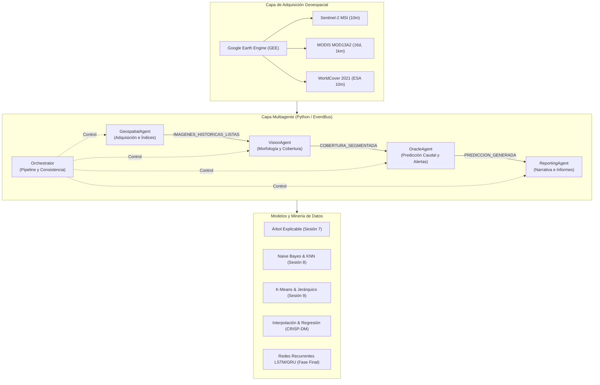
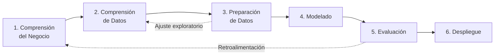

# Análisis Integral de Arquitectura y Metodología CRISP-DM: Skyfusion Analytics

> **Proyecto:** Skyfusion Analytics — Monitoreo Geoespacial, Redes Neuronales y Gestión del Riesgo Hídrico en la Cuenca del Río Combeima (Ibagué, Tolima)  
> **Curso:** Minería de Datos · UNIMINUTO Ibagué · 2026-2  
> **Marco Metodológico:** CRISP-DM (Cross-Industry Standard Process for Data Mining)

---

## 1. Visión General del Sistema y Caso de Negocio

La cuenca del río Combeima es la principal fuente de abastecimiento hídrico del municipio de Ibagué (~80 % del agua potable de la ciudad) y una de las zonas de mayor vulnerabilidad ante amenazas hidroclimáticas (deslizamientos, avenidas torrenciales, pérdida de cobertura vegetal y presión por expansión urbana).

**Skyfusion Analytics** es un sistema inteligente de monitoreo hidroclimático y detección de cambios de cobertura del suelo que integra:
- Teledetección y sensores remotos (Google Earth Engine: Sentinel-2 MSI, Landsat 8/9 OLI, MODIS MOD13A2).
- Modelos de Inteligencia Artificial y Minería de Datos (Árboles de decisión explicables, Naive Bayes, KNN, K-Means, Redes Neuronales Recurrentes LSTM/GRU/TCN, y regresiones lineales de tendencia).
- Arquitectura multiagente orientada a eventos para toma de decisiones y generación automatizada de alertas preventivas.

---

## 2. Las 6 Fases de CRISP-DM aplicadas a Skyfusion Analytics

### Fase 1: Comprensión del Negocio (Business Understanding)
- **Problema de Negocio:** Evitar desabastecimientos de agua en Ibagué y alertar oportunamente sobre avenidas torrenciales o degradación de la cuenca alta del río Combeima.
- **Objetivos de Minería de Datos:**
  1. *Supervisado:* Clasificar con precisión y auditabilidad 7 tipos de cobertura (agua, arbustal, bosque, cultivo, pastizal, suelo desnudo, urbano).
  2. *No Supervisado:* Descubrir agrupaciones espectrales naturales de la cuenca (cuerpos de agua, suelo en riesgo, vegetación) para emitir alertas segmentadas.
  3. *Regresión y Series Temporales:* Predecir tendencias multitemporales de vegetación (NDVI) y caudal fluvial ($m^3/s$) mitigando vacíos por nubosidad.
- **Criterio de Éxito:** Macro-F1 > 0.65 en clasificación multiclase; $R^2 > 0.70$ y residuos no sesgados en regresión; interpretabilidad directa para comités de gestión del riesgo.

### Fase 2: Comprensión de los Datos (Data Understanding)
- **Fuentes:**
  - `sentinel2_combeima_clases.csv`: 1.924 píxeles etiquetados con WorldCover 2021, 6 bandas espectrales (B2, B3, B4, B8, B11, B12) y 5 variables derivadas (NDVI, NDWI, NDBI, B8/B4 ratio, temporada lluviosa).
  - `series_multisensor_combeima.csv`: 4.016 registros temporales de MODIS (2015-2024) con reflectancia, QA, NDVI y EVI.
- **Patrones Clave:** Fuerte correlación entre bandas visibles e infrarrojas; presencia de valores faltantes y nubes en épocas lluviosas (abril-mayo, octubre-noviembre).

### Fase 3: Preparación de los Datos (Data Preparation)
- **Tratamiento de Datos Faltantes:** Implementación de **Interpolación** matemática (lineal, basada en tiempo, spline cúbico, PCHIP) para reconstruir curvas continuas sin discontinuidades artificiales.
- **Partición sin Fuga:** Split estratificado congelado (semilla 42, 75 % train = 1.443, 25 % test = 481).
- **Escalamiento:** Estandarización con `StandardScaler` ajustado **únicamente** en conjunto de entrenamiento dentro de `Pipeline` para evitar data leakage.

### Fase 4: Modelado (Modeling)
- **Modelos Clasificadores:**
  - Árbol de decisión (`DecisionTreeClassifier`, depth 5, entropy) como modelo explicable de reglas.
  - Naive Bayes (`GaussianNB`) como línea base probabilística de alta velocidad.
  - K-Vecinos más cercanos (`KNeighborsClassifier`) con optimización de $k \in \{1, 5, 11, 31, 101\}$.
- **Segmentación No Supervisada:**
  - `KMeans` sobre bandas normalizadas ($k=2..8$), evaluando inercia y silueta, seleccionando $k=3$.
  - Clustering Jerárquico aglomerativo (`ward`) sobre muestra de 60 píxeles.
- **Regresión Lineal:** Modelado de tendencia temporal de índices (OLS) y regresión multivariada regularizada (Ridge/Lasso).

### Fase 5: Evaluación (Evaluation)
- **Clasificación:** Comparación multidimensional (Accuracy train/test, Macro-F1, Balanced Accuracy, tiempo de inferencia).
- **Clustering:** Silueta promedio, inercia, interpretabilidad física y porcentaje de pureza de perfiles según clases WorldCover.
- **Regresión:** $R^2$, RMSE, MAE, pruebas de residuos (Shapiro-Wilk para normalidad, Durbin-Watson para autocorrelación).

### Fase 6: Despliegue (Deployment)
- Generación de scripts reproducibles en `sesion8/codigo/`, `sesion9/codigo/`, `skills/ml_tools/` y `scripts/`.
- Presentaciones interactivas HTML para socialización ejecutiva y académica.
- Cuadernos Jupyter (`modelos_v1_avance2.ipynb`, `04_crisp_dm_interpolacion_regresion.ipynb`).
- Integración en los agentes Python de Skyfusion Analytics.

---

## 3. Matriz de Mapeo de Acciones Skyfusion por Segmento / Modelo

| Componente | Hallazgo / Salida | Agente Responsable | Acción en Skyfusion |
|---|---|---|---|
| **Árbol (Sesión 7)** | Regla: NDWI > -0.32 & B11 <= 1480 → Agua (pureza 100%) | `VisionAgent` $\rightarrow$ `OracleAgent` | Delineación precisa del cauce activo del Combeima |
| **Árbol (Sesión 7)** | Regla: NDBI > 0.13 & B11 > 1480 → Urbano (pureza 92%) | `VisionAgent` $\rightarrow$ `ReportingAgent` | Alerta de expansión urbana en zonas de ronda hídrica |
| **KNN k=5 (Sesión 8)** | Accuracy 0.7443 / Macro-F1 0.7301 | `OracleAgent` | Inferencia espectral de píxeles no clasificados por vecinos |
| **K-Means Z2 (Sesión 9)** | Zona Cuerpos de Agua (94,5% agua) | `OracleAgent` $\rightarrow$ `ReportingAgent` | Monitoreo continuo de espejo hídrico y caudal base |
| **K-Means Z1 (Sesión 9)** | Zona Suelo Urbano-Desnudo (riesgo) | `VisionAgent` $\rightarrow$ `ReportingAgent` | Alerta por riesgo de erosión y desprendimiento de ladera |
| **K-Means Z0 (Sesión 9)** | Zona Vegetación Mixta (bosque/cultivo) | `VisionAgent` | Seguimiento de salud vegetal y estrés hídrico |
| **Regresión CRISP-DM** | Pendiente temporal $\beta_1$ en NDVI y caudal | `ReportingAgent` | Proyección de recarga hídrica estacional para IBAL |
